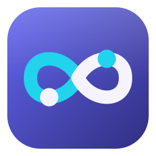

<div align="center">



# Continuous

**A community-maintained fork of the Continue VS Code extension.**

</div>

> **Unofficial fork.** Continuous is not affiliated with, endorsed by, or supported by Continue Dev, Inc. The upstream `continuedev/continue` repository is no longer maintained. This fork carries its own changes (AWS Bedrock and Bedrock Mantle support, live model lists, and more) and is released separately.

## Install

Continuous needs a recent VS Code (1.105 or newer).

**From VS Code or the Marketplace** (the usual way):

- In VS Code, open the Extensions view (`Ctrl+Shift+X`), search for **Continuous**, and select **Install**. Check the publisher is `b1tninja`.
- Or open the [Continuous page on the Visual Studio Marketplace](https://marketplace.visualstudio.com/items?itemName=b1tninja.continuous) and select **Install**.
- Or from a terminal:

  ```bash
  code --install-extension b1tninja.continuous
  ```

VS Code keeps the extension up to date. The Marketplace extension ID is `b1tninja.continuous`.

**From a GitHub release** (to install by hand, or where the Marketplace is not reachable):

1. Download the `.vsix` for your platform from the [latest release](https://github.com/b1tninja/continuous/releases/latest). There are builds for Windows (x64, Arm64), macOS (Apple Silicon, Intel), and Linux (x64, Arm64). Each release has a `SHA256SUMS.txt` to check the download against.
2. Install it, then reload VS Code (**Developer: Reload Window**):

   ```bash
   code --install-extension <the file you downloaded>.vsix --force
   ```

Or, with the GitHub CLI (change `win32-x64` to your platform):

```bash
gh release download --repo b1tninja/continuous --pattern "continuous-win32-x64-*.vsix" --pattern SHA256SUMS.txt --dir continuous-vsix
```

Continuous installs alongside the original Continue extension. Its configuration is in `~/.continuous`, which the first start copies from an existing `~/.continue`. If you installed one of the early releases, which used the ID `b1tninja.continued`, uninstall that one after installing Continuous ([details](docs/continuous-install.md#4-reload-vs-code)).

The [install guide](docs/continuous-install.md) has every platform's file name, checksum commands, unreleased builds from GitHub Actions, and troubleshooting.

## What's different from upstream

Continuous adds what upstream stopped before reaching. The release notes list every change; this is the shape of it.

**Models and providers**

- **Amazon Bedrock and Bedrock Mantle**: one model list across both endpoints, bearer API keys, reasoning and tool support by model family (Claude, Nova, Qwen3, DeepSeek, Mistral and others), and access errors that say what to check.
- **A model catalog.** Define each model once in `models.yaml` with the account that serves it, and refer to it with `from: Name`. Provider setup tests the connection, shows the live list of models your account can use, and stores the key in VS Code's secret storage.
- **Local servers** (Strata, llama.cpp, vLLM, LM Studio, Ollama): detection, prompt-processing progress in the toolbar, and a warning before a change would make the server re-read the whole conversation.
- **Current models**: refreshed lists for Anthropic (including Claude 5), OpenAI, Gemini and Bedrock, and adaptive thinking for Claude 4.6 and later, which those models require.
- **Which model does what.** Separate models, reasoning effort, prompt and reminder text for chat, plan, agent, loop, re-plan, reviewer and subagents.

**Agents, plans and loops**

- **Plan mode** ends with a saved plan file and **Build** or **Keep planning**; choices you kept for yourself become decisions on the plan.
- **Loop mode** builds a plan's to-dos one at a time, each in a fresh context, with a check that must pass for an item to count as done, an inbox for the model's questions, budgets, and three autonomy levels (Supervised, Auto, Unattended). It runs in the IDE, in the CLI and headless through `cn serve`.
- **Subagents** from `.continue/agents/` (and Claude Code's `.claude/agents/`), each with its own card, model, tokens and Stop.
- **Task lists** kept with the session, so compaction does not lose the agent's place, and a queue for messages typed while it works.
- **A terminal agent**, `continuous`, installable from each release.

**Safety and control**

- **Tool permissions**: `toolPermissions` rules (allow, ask, deny) with **Always allow**, approval modes, five policy areas with levels, protected paths that always ask, and a floor deny list that even YOLO cannot pass. Deny and ask rules read a command the way the shell will, so quoting tricks and wrappers do not hide it.
- **An optional reviewer model** that approves or refuses calls in Auto mode, judging a fenced digest and never the tool output (in the code on `main`; measurement on a real model is still open).
- **Checkpoints** for agent file edits, with **Restore to here**.
- **Your config stays yours**: no telemetry, and config files get their own schemas and in-editor problems.

**Cost and speed**

- **Prompt caching controls** for Anthropic, Bedrock, Vertex AI and OpenRouter: 5-minute, 1-hour and Auto lifetimes, cache points for Amazon Nova, a prompt prefix kept stable between requests, notices before a change would make the cache go cold, and a session summary of reads, writes and cost.

**VS Code**

- **The agent uses the language servers** (symbols, definitions, references, problems), your models and MCP servers appear in VS Code's own pickers, and Continuous adds itself to the Agents window.

## What each release added

| Release | Headline                                                                                                                                                                |
| ------- | ----------------------------------------------------------------------------------------------------------------------------------------------------------------------- |
| 2.2     | Provider setup with live model lists, Bedrock and Mantle, per-mode models, prompt caching controls, tool permissions and approval modes, protected paths, checkpoints   |
| 2.4     | Subagents, saved plan files and task lists, queued messages, local model servers, the model catalog and variants, a stable cached prompt, VS Code's model and MCP lists |
| 2.4.2   | The name Continuous: its own `~/.continuous` folder, `continuous.*` settings, with the old names still read                                                             |
| 2.6     | Loop mode with autonomy levels, checks and an inbox, policy areas, Bedrock by model family, Nova caching, the terminal agent and `cn serve`, language-server tools      |
| 2.6.1   | Policy areas wired through the IDE, CLI and loops, command analysis, a Loops panel, and the toolbox drawer of problem-solving prompts                                   |
| 2.8     | The command lint, `effect:` rules for commands, an editable task list with real checkboxes and drag-to-reorder, and new documentation pages                             |
| 2.8.1   | Run the agent's terminal commands in WSL, and parallel waves of loop items in the terminal agent                                                                        |
| 2.8.2   | A two-phase infinity as the Loop mark and the logo, and narrower policy chips with a glyph and colour for each level                                                    |

## Where it is heading

The plans live in [`plans/`](plans/); [`plans/ROADMAP.md`](plans/ROADMAP.md) is the index, with a state for every item. Ideas on it now, none shipped:

- **Command safety**: a lint that catches broken heredocs and wrong-shell syntax before a command runs (started), classification of commands by what they do (network, write, delete, exec) so rules can say `effect:network`, and a shellcheck-class pass.
- **Isolation**: run commands in WSL, in a container or a dev container, or inside an OS sandbox, and run whole loops in a jail with the model key kept outside, so autonomy can rest on a guarantee the interface can state.
- **Staying on track**: stuck detection beyond identical calls, a work log, and guidance drawn from the toolbox; loop budgets by cost, turns, tokens and time, with live meters.
- **Memory**: ageing old history to disk, windowed scrolling, and a memory panel, so a long session does not run the machine out of memory.
- **Speaking each model's language**: a translation layer that renders and reads each family's native tool-call format (Qwen's XML, Hermes JSON, Harmony, Kimi and others) instead of forcing one on every model.
- **Review**: reviewers that start from a clean, cached prefix, isolated from the agent they judge.
- **Parallel agents**: an agents panel, worktrees, and agent-to-agent messaging.

## Documentation

The documentation is at [b1tninja.github.io/continuous](https://b1tninja.github.io/continuous/), built from `docs/`. It still describes upstream Continue in places and is being revised. What changed in each release is in the [release notes](https://github.com/b1tninja/continuous/releases).

## Upstream

This fork starts from the final release of Continue (`continuedev/continue`, VS Code extension 2.0.0). Upstream is no longer maintained, and its JetBrains plugin and its own Marketplace listing are not part of this fork. The terminal agent is carried over and named `continuous`. Upstream's project history and contributors are at [continuedev/continue](https://github.com/continuedev/continue).

## License

Apache 2.0. The original work is © 2023–2026 Continue Dev, Inc. Changes in this fork are © 2026 b1tninja. See [LICENSE](LICENSE). This fork is not endorsed by or affiliated with Continue Dev, Inc.
